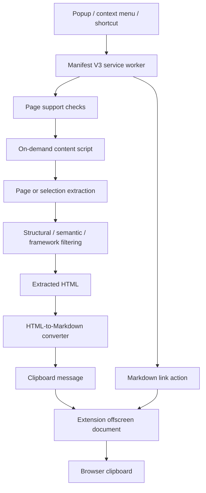

# How Copy 2 Markdown is put together

The short version: the extension dispatches a user action, extracts the requested page content,
converts the resulting HTML to Markdown, and writes it through an extension-owned clipboard
context. The work stays in the browser.

## The shape of the extension

The diagram shows the main path. Page and selection actions use the content script; link actions
can be assembled in the service worker without extracting page content.

## A user action starts the work

The service worker in `src/background.ts` registers context menus and handles extension commands.
It checks whether the target page is supported, then sends a typed request to the content script.
If the script is not present yet, it injects the bundled `content.js` into the active tab and retries
the message.

The extension popup uses the same action model. It does not maintain a second extraction or
conversion pipeline.

## Extraction and conversion have separate boundaries

`src/content/extraction.ts` produces HTML for either the current page or the current selection.
Page extraction tries Mozilla Readability first, then uses a cleaned fallback when the page is not
article-shaped or Readability does not return enough text. The filtering policies are kept in
`src/content/filtering/` rather than being mixed into the converter.

`src/conversion/markdown.ts` turns the extracted HTML into Markdown. It does not depend on Chrome
APIs, so conversion can be tested directly with HTML fragments. This boundary also keeps URL
handling, Markdown formatting, and extraction decisions from becoming one large operation.

## Clipboard access has its own context

The content script sends the Markdown to the extension's clipboard helper. The background path
uses the same extension-owned offscreen document for actions that originate in the service worker.
The offscreen document performs the clipboard write using the `clipboardWrite` permission.

This keeps clipboard handling out of the page DOM and avoids asking a webpage to perform an
extension operation on the extension's behalf. See [Clipboard and permissions](clipboard-and-permissions.md).

## Local-first by design

The extension does not have an account system, application backend, analytics service, or remote
content-processing endpoint. Page access is requested through `activeTab` after an action is
invoked; persistent host permissions are not part of the manifest.

That keeps the operational shape small: there is no service to receive copied content and no
application data store to maintain. Chrome still manages extension installation and its own
platform-level services independently.
